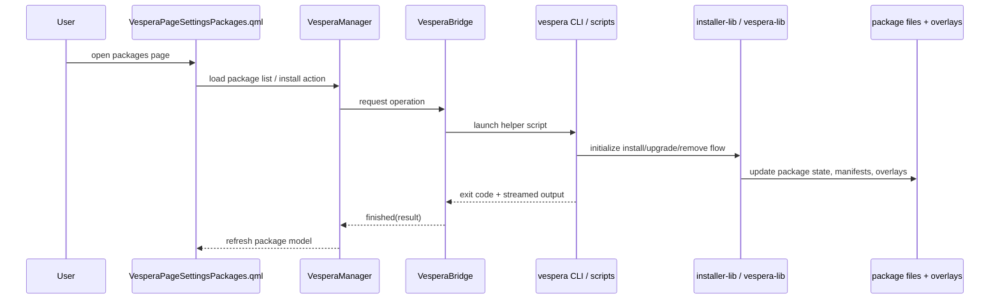
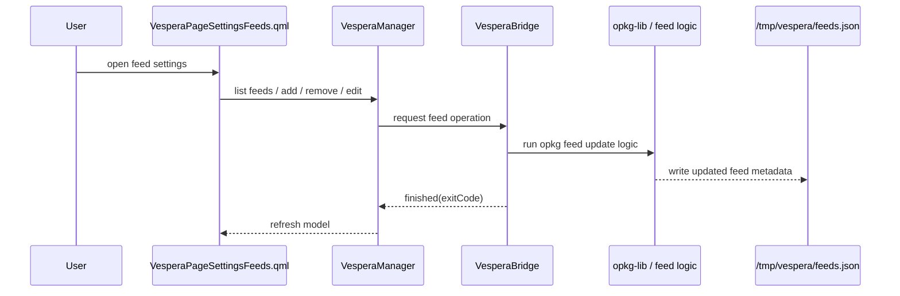
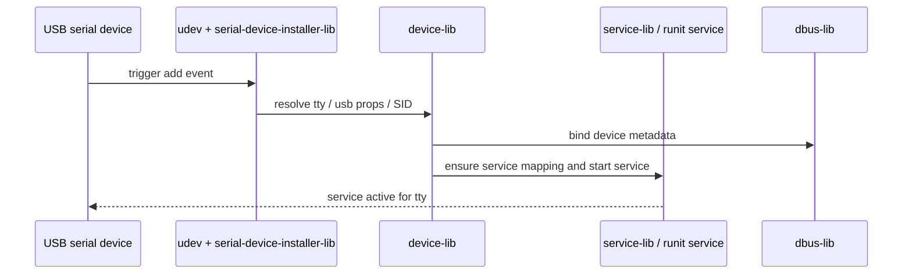
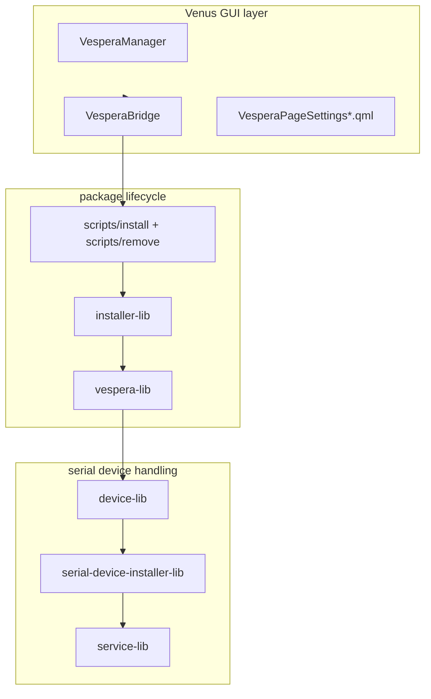
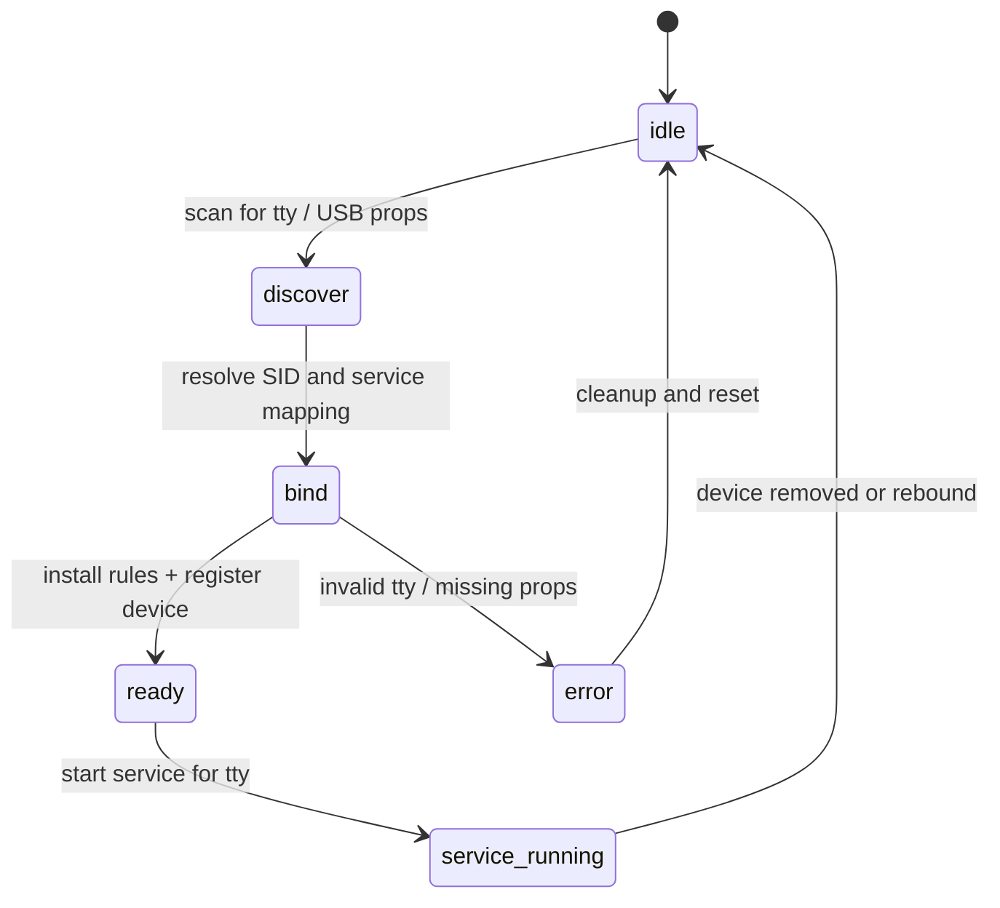

# Vespera Mermaid diagrams

This document captures the current code-level flows for the Vespera addon.

Related: [Installer Integration Patterns (Developer Note)](installer-integration-patterns.md)

## 1) High-level architecture

```mermaid
flowchart LR
    UI[QML pages\nVesperaHomePage / VesperaPageSettings*.qml] --> MANAGER[VesperaManager]
    MANAGER --> BRIDGE[VesperaBridge]

    BRIDGE --> CLI[vespera CLI / helper scripts]
    CLI --> LIBS[libs/installer-lib\nlibs/opkg-lib\nlibs/device-lib\nlibs/serial-device-installer-lib]
    CLI --> DATA[/data/apps/available/vespera/]

    LIBS --> CONF[conf/vespera.conf\nconf-default/vespera.conf]
    LIBS --> STATE[/tmp/vespera/\nstatus and indexes]
    UI --> JSON[VesperaJsonReader / JSON cache]
    JSON --> STATE
```

## 2) Package install / upgrade / remove flow



## 3) Feed management flow



## 4) Device binding lifecycle



## 5) Responsibility map



The current design separates:
- GUI concerns in the QML layer
- package lifecycle in the installer and helper scripts
- serial device binding in `device-lib` and `serial-device-installer-lib`
- runtime restarts and state cleanup in `vespera-lib` and `service-lib`

## 6) Device setup state flow



## Source anchors

- [src/opt/victronenergy/gui/qml/VesperaManager.qml](../src/opt/victronenergy/gui/qml/VesperaManager.qml)
- [src/opt/victronenergy/gui/qml/VesperaBridge.qml](../src/opt/victronenergy/gui/qml/VesperaBridge.qml)
- [src/opt/victronenergy/gui/qml/VesperaPageSettingsPackages.qml](../src/opt/victronenergy/gui/qml/VesperaPageSettingsPackages.qml)
- [src/opt/victronenergy/gui/qml/VesperaPageSettingsFeeds.qml](../src/opt/victronenergy/gui/qml/VesperaPageSettingsFeeds.qml)
- [src/data/apps/available/vespera/vespera](../src/data/apps/available/vespera/vespera)
- [src/data/apps/available/vespera/libs/device-lib](../src/data/apps/available/vespera/libs/device-lib)
- [src/data/apps/available/vespera/libs/serial-device-installer-lib](../src/data/apps/available/vespera/libs/serial-device-installer-lib)