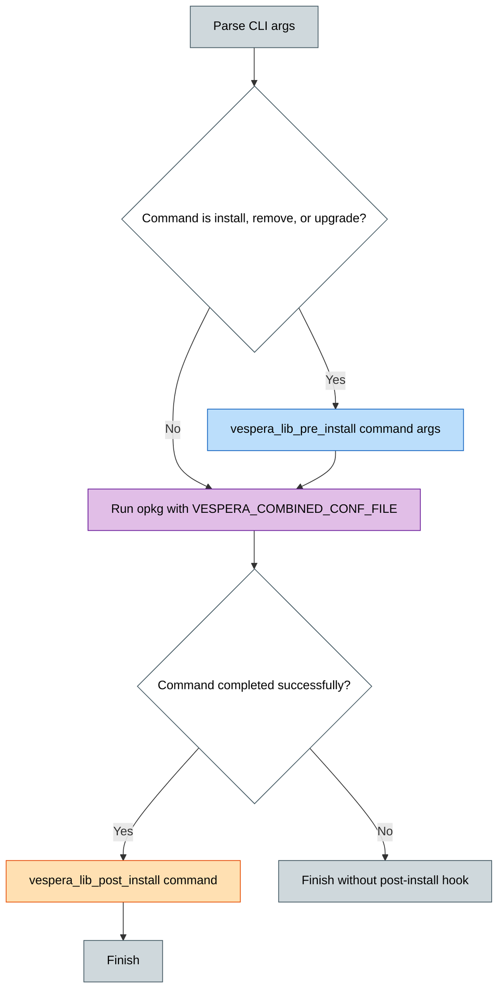
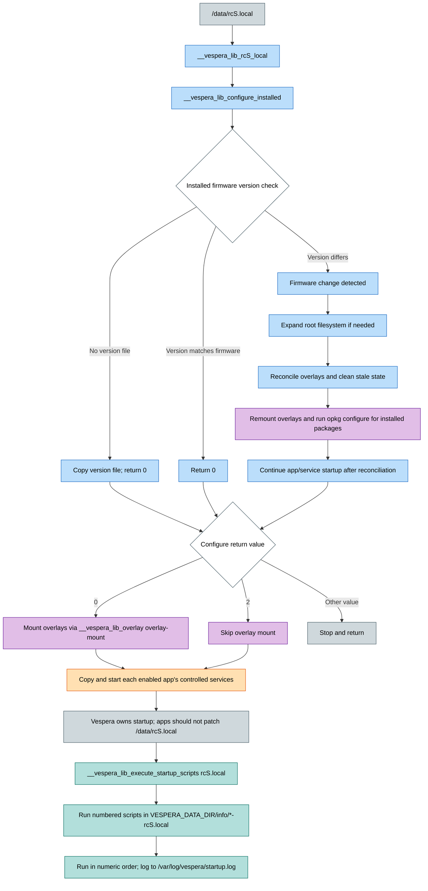
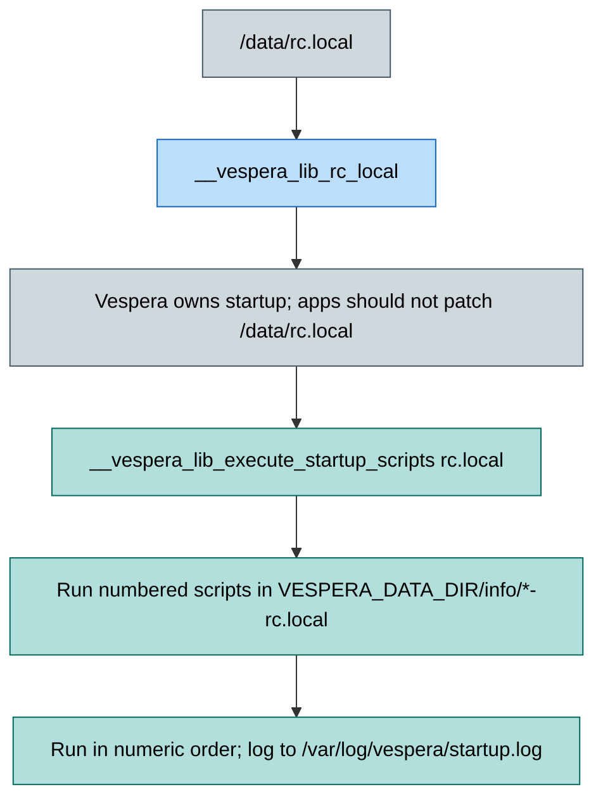

# Vespera package lifecycle

This document captures the package-manager lifecycle and startup flow described in the Vespera library.

> Source: `vespera-lib` in the Vespera app package.

## Overview

The Vespera CLI wraps `opkg` rather than replacing it. The underlying package manager lifecycle remains in `opkg`; Vespera adds the pre/post hook orchestration, overlay reconciliation, service control, and install-state tracking around it.

## Diagram colour key

Colours are consistent across all diagrams below.

- ⬜ Entry point, notes and end states
- 🟦 Vespera pre-install hook / boot reconciliation
- 🟪 `opkg` and package scripts (`preinst`, `postinst`, `prerm`, `postrm`, overlay register/unregister)
- 🟩 `installer-lib` steps
- 🟨 Install-state file
- 🟧 Vespera post-install hook / service start
- Teal: numbered startup scripts

## Wrapper flow

## Package manager lifecycle

The Install, Remove and Upgrade flows are shown side by side so matching steps can be compared (same colours as above).

```mermaid
%%{init: {"flowchart": {"wrappingWidth": 260}}}%%
flowchart TD
    anchor[" "]
    anchor ~~~ iA
    anchor ~~~ uA
    anchor ~~~ rA

    subgraph INSTALL["Install"]
        direction TB
        iA["vespera install pkg"] --> iB["vespera_lib_pre_install install"]
        iB --> iC["Guard against concurrent GUI/package activity"]
        iC --> iD["__vespera_lib_initialize: set temporary working dir and lock state"]
        iD --> iE["Verify filesystem and package-use constraints"]
        iE --> iF["opkg install pkg"]
        iF --> iG["CONTROL/preinst: overlay-register pkg"]
        iG --> iH["Unpack package files"]
        iH --> iI["CONTROL/postinst: pkg.installer install"]
        iI --> iJ["Initialize installer-lib: install"]
        iJ --> iK["__installer_lib_process_default_conf_files"]
        iK --> iL["__installer_lib_init_overlay_paths"]
        iL --> iM["__installer_lib_write_dbus_settings_to_dbus_list_file"]
        iM --> iN["__installer_lib_patch_files add"]
        iN --> iO["__installer_lib_add_dbus_settings_from_dbus_list_file"]
        iO --> iP["__installer_lib_phase_apply_runtime"]
        iP --> iQ["Write package state to VESPERA_INSTALL_STATE_FILE"]
        iQ --> iR["Package script completes"]
        iR --> iS["vespera_lib_post_install install"]
        iS --> iT["Send GUI interrupt signal"]
        iT --> iU["Process install state from VESPERA_INSTALL_STATE_FILE"]
        iU --> iV["Enable apps, refresh devices, restart services as needed"]
        iV --> iW["vespera_lib_index"]
        iW --> iX["Clean up"]
    end

    subgraph UPGRADE["Upgrade"]
        direction TB
        uA["vespera upgrade pkg"] --> uB["vespera_lib_pre_install upgrade"]
        uB --> uC["Guard against concurrent GUI/package activity"]
        uC --> uD["__vespera_lib_initialize: set temporary working dir and lock state"]
        uD --> uE["Verify upgrade path and filesystem constraints"]
        uE --> uF["opkg upgrade pkg"]
        uF --> uG["Old package CONTROL/prerm: oldpkg.installer upgrade-remove"]
        uG --> uH["Initialize installer-lib: remove (upgrade path)"]
        uH --> uI["__installer_lib_patch_files remove"]
        uI --> uJ["__installer_lib_remove_dbus_settings_from_file"]
        uJ --> uK["__installer_lib_phase_remove_runtime"]
        uK --> uL["__installer_lib_remove_cleanup"]
        uL --> uM["New package CONTROL/preinst: overlay-register pkg"]
        uM --> uN["Unpack new package files"]
        uN --> uO["New package CONTROL/postinst: newpkg.installer upgrade-install"]
        uO --> uP["Initialize installer-lib: install (upgrade path)"]
        uP --> uQ["Preserve enabled state and detect upgrade"]
        uQ --> uR["__installer_lib_write_dbus_settings_to_dbus_list_file"]
        uR --> uS["__installer_lib_patch_files add"]
        uS --> uT["__installer_lib_add_dbus_settings_from_dbus_list_file"]
        uT --> uU["__installer_lib_phase_apply_runtime"]
				uU --> uLL["Write package state to VESPERA_INSTALL_STATE_FILE"]
        uLL --> uV["Old package CONTROL/postrm: overlay-unregister unless upgrade path is active"]
        uV --> uW["vespera_lib_post_install upgrade"]
        uW --> uX["Send GUI interrupt signal"]
        uX --> uY["Process install state from VESPERA_INSTALL_STATE_FILE"]
        uY --> uZ["Re-enable apps, restart services as needed"]
        uZ --> uAA["vespera_lib_index"]
        uAA --> uAB["Clean up"]
    end

    subgraph REMOVE["Remove"]
        direction TB
        rA["vespera remove pkg"] --> rB["vespera_lib_pre_install remove"]
        rB --> rC["Guard against concurrent GUI/package activity"]
        rC --> rD["__vespera_lib_initialize: set temporary working dir and lock state"]
        rD --> rE["Verify package can be removed safely"]
        rE --> rF["opkg remove pkg"]
        rF --> rG["CONTROL/prerm: overlay-register pkg; call installer-lib"]
        rG --> rH["Initialize installer-lib: remove"]
        rH --> rI["__installer_lib_patch_files remove"]
        rI --> rJ["__installer_lib_remove_dbus_settings_from_file"]
        rJ --> rK["__installer_lib_phase_remove_runtime"]
        rK --> rL["Write package state to VESPERA_INSTALL_STATE_FILE"]
        rL --> rM["__installer_lib_remove_cleanup"]
        rM --> rN["Delete package files"]
        rN --> rO["CONTROL/postrm: overlay-unregister unless upgrade path is active"]
        rO --> rP["vespera_lib_post_install remove"]
        rP --> rQ["Send GUI interrupt signal"]
        rQ --> rR["Process install state from VESPERA_INSTALL_STATE_FILE"]
        rR --> rS["Restart services as needed"]
        rS --> rT["vespera_lib_index"]
        rT --> rU["Clean up"]
    end

    classDef entry fill:#cfd8dc,stroke:#455a64,color:#000
    classDef pre fill:#bbdefb,stroke:#1565c0,color:#000
    classDef opkg fill:#e1bee7,stroke:#6a1b9a,color:#000
    classDef inst fill:#c8e6c9,stroke:#2e7d32,color:#000
    classDef state fill:#fff9c4,stroke:#f9a825,color:#000
    classDef post fill:#ffe0b2,stroke:#e65100,color:#000

    classDef hidden fill:none,stroke:none,color:none
    class anchor hidden

    class iA,rA,uA entry
    class iB,iC,iD,iE,rB,rC,rD,rE,uB,uC,uD,uE pre
    class iF,iG,iH,iI,iR,rF,rG,rN,rO,uF,uG,uM,uN,uO,uV opkg
    class iJ,iK,iL,iM,iN,iO,iP,rH,rI,rJ,rK,rM,uH,uI,uJ,uK,uL,uP,uQ,uR,uS,uT,uU inst
    class iQ,rL,uLL state
    class iS,iT,iU,iV,iW,iX,rP,rQ,rR,rS,rT,rU,uW,uX,uY,uZ,uAA,uAB post
```

## Installer files

Each package ships a small set of `installer*` files in its `CONTROL/` directory. `opkg` installs them as `/data/var/vespera/info/<pkg>.<name>` (for example `dbus-inetbox.installer-overlays`), where the lifecycle scripts and boot scripts read them. Packages only supply the data; the shared logic lives in the Vespera libraries and must not be duplicated in a package.

### Package-supplied files

| File&nbsp;&nbsp;&nbsp;&nbsp;&nbsp;&nbsp;&nbsp;&nbsp;&nbsp;&nbsp;&nbsp;&nbsp;&nbsp;&nbsp;&nbsp;&nbsp;&nbsp;&nbsp;&nbsp;&nbsp;&nbsp;&nbsp;&nbsp;&nbsp;&nbsp;&nbsp;&nbsp;&nbsp; | Required | Purpose |
|----|---|---|
| `installer` | Yes | Package configuration and optional lifecycle callbacks (shell). |
| `installer-overlays` | Optional | Directories the package overlays. Without it, no overlays are registered. |
| `installer-services` | Optional | Venus services to restart on enable/disable/remove. Without it, no services are restarted. |
| `installer-whiteouts` | Optional | Deleted files to keep deleted in an overlay. Without it, no whiteouts are preserved. |
| `installer*-patch` | Optional | Patches applied to existing Venus files. |

#### `<pkg>.installer`

A shell fragment that is sourced by `installer-lib` (it is never executed on its own). It should contain only variable assignments and, optionally, callback functions.

Variables (all optional; unset ones default to empty):

| Variable | Contents |
|---|---|
| `PACKAGE_DBUS_NAME` | Name used under `/Settings/Vespera/Packages/<name>`. Defaults to the package name with spaces and `-` replaced by `_`. |
| `PACKAGE_DBUS_SETTINGS` | One JSON object per line, e.g. `{"path":"/Settings/Vespera/Version", "default": 1, "min":0, "max":0}`. |
| `PACKAGE_CUSTOM_MENUS` | Whitespace-separated `key=value` entries (or bare `key`), registered under `/Settings/Vespera/CustomMenuPages`. |
| `PACKAGE_CUSTOM_OVERVIEW_PAGES` | Same format, registered under `/Settings/Vespera/CustomOverviewPages`. |
| `PACKAGE_CUSTOM_NAV_PAGES` | Pages added to (and removed from) the custom navigation pages setting. |
| `PACKAGE_DEVICES` | Devices the package provides; used with `PACKAGE_DBUS_NAME` to register a custom service. |
| `RCS_LOCAL_SCRIPT` | Text appended to `/data/rcS.local` on install and removed on uninstall. |
| `RC_LOCAL_SCRIPT` | Same, for `/data/rc.local`. |

Callbacks (optional functions): `pre_install`, `post_install`, `pre_remove`, `post_remove`, `firmware_changed`. They take no arguments; `$PACKAGE_ACTION` is available to tell the cases apart. Valid actions are `install`, `upgrade-install`, `configure`, `dev-install`, `remove`, `upgrade-remove`, `dev-remove` and `firmware-changed`.

#### `<pkg>.installer-overlays`

One absolute directory per line (`#` starts a comment). Each directory is overlay-mounted so the package can add or patch files without modifying the read-only firmware. Registered by `preinst` and on enable, unregistered by `postrm` (except during an upgrade), and re-mounted at boot by `rcS.local`. A directory shared by several packages uses a single mount. Keep this list to directories the package really writes to.

#### `<pkg>.installer-services`

One Venus service path per line (`#` comments), for example `/service/gui`. These services are restarted when the package is enabled, disabled or removed. On remove the file is copied to the working directory first, because the original is deleted with the package.

#### `<pkg>.installer-whiteouts`

One absolute file path per line (`#` comments) for files the package deliberately hides (deletes) from an overlay. At boot, overlay reconciliation deletes every stale entry from an overlay's upper layer: files not owned by an installed package, and whiteouts not listed here. A file that is not listed is restored. Optional; a missing file is treated as empty.

#### `<pkg>.installer*-patch`

Any file matching `<pkg>.installer*-patch` is applied at install time by `file-patcher-lib`. Use several files (for example `installer-gui-patch`) to keep patches separate. Each patch is a series of `@command` lines, each followed by a block delimited by `====`:

| Command | Meaning |
|---|---|
| `@openfile [version]` | Target file. An optional Venus version condition (`<3.70`, `>=3.70`) makes the block conditional. |
| `@find` / `@findbackwards` | Move to the first/last occurrence of the block's text. |
| `@insertbefore` / `@insertafter` | Insert the block relative to the current position. Skipped if the text is already present. |
| `@append` | Append the block to the end of the file. |
| `@remove` | Comment out the matched text. |

Patches should be idempotent and carry a marker comment (for example `// vespera 1.0`). Patched files are recorded in `/data/var/vespera/patch.list`. On remove the patch is reverted, and when no package patches a file any longer, its copy in the overlay is deleted so the original shows again.

### Shared libraries

These ship with Vespera and should not be copied into packages.

| File&nbsp;&nbsp;&nbsp;&nbsp;&nbsp;&nbsp;&nbsp;&nbsp;&nbsp;&nbsp;&nbsp;&nbsp;&nbsp;&nbsp;&nbsp;&nbsp;&nbsp;&nbsp;&nbsp;&nbsp;&nbsp;&nbsp;&nbsp;&nbsp; | Purpose |
|---|---|
| `installer-lib` | Entry point for `install` and `remove`. Reads the arguments (action, installer file, working directory, verbosity), sources `<pkg>.installer`, applies defaults, and provides helpers: `installer_lib_is_upgrade`, `installer_lib_is_remove`, `installer_lib_update_install_list` (writes the install-state file) and `installer_lib_get_patch_file_list`. |
| `installer-dbus-lib` | Builds the package's DBus manifest (`<pkg>.dbus-list`) from the `PACKAGE_*` variables, applies it on install, computes the added/removed delta on upgrade, and removes the settings on uninstall. |
| `serial-device-installer-lib` | Adds and removes serial-starter mappings for packages that provide device service templates. |

## Vespera boot lifecycle

### /data/rcS.local

### /data/rc.local

## Startup script convention

- Numbered filenames determine execution order.
- Scripts are discovered under `$VESPERA_DATA_DIR/info/`.
- Each script is run as part of the `rcS.local` / `rc.local` boot chain.
- Execution is logged to `/var/log/vespera/startup.log`.

## Key design note

Vespera does not replace the package manager; it wraps `opkg` with lifecycle hooks, overlay reconciliation, service management, and app state transitions that keep the package installation model and boot model consistent across firmware upgrades and app changes.
