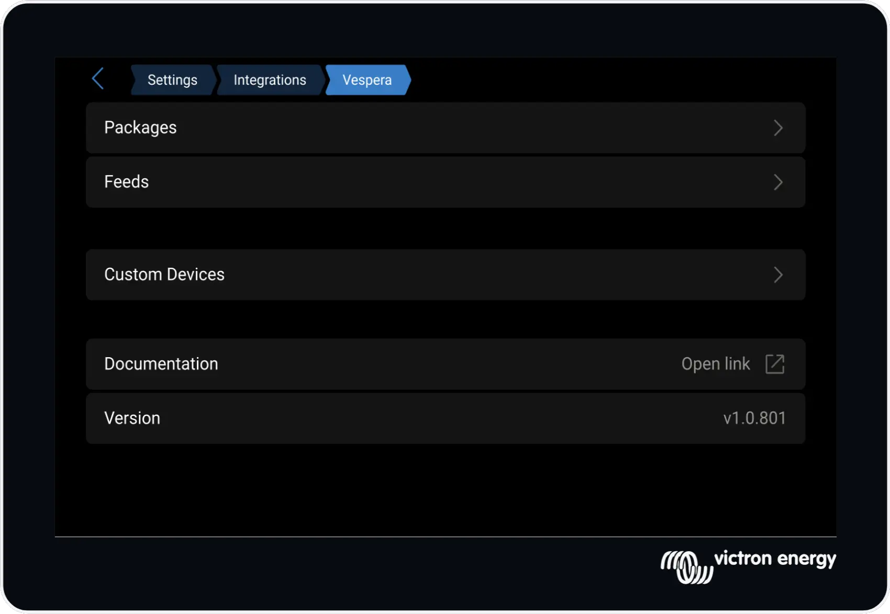

# Vespera Overview
Vespera - *The evening star of Venus*

Vespera allows end users to install and manage `opkg` packages (add-ons) on the Venus OS without requiring SSH shell commands. It also allows users to manage custom feeds for third-party add-ons and configure custom usb serial devices.

## Features
* Open source
* Works in the new GUI-v2 and Classic UI
* Based on Open Package Manager (opkg)
* Deterministic installs, install and remove packages, in any order
* Scan for and set up USB Serial Devices from the GUI or via the Command line Interface (CLI)
* Use local, lan or remote feeds as the source of addins
* Add custom feeds from 3rd parties
* Keeps the Veuns file system readonly, Does not alter the Venus OS file system, except for /data which is writable.
* Enable and disable addons without uninstalling
* Can be installed via a "blind" install (from sdcard, without using ssh), or via ssh using 2 commands.
* Translated to 14 languages
* Automaticaly restarts services and templated servces on reboot.
* Detects firmware changes (upgrade and downgrade).
* Command Line Interface (CLI) with commands like:
``` bash
root@enstine:~\# vespera list
root@enstine:~\# vespera list-installed
root@enstine:~\# vespera list-enabled <package name>
root@enstine:~\# vespera install <package name>
root@enstine:~\# vespera remove <package name>
root@enstine:~\# vespera enable <package name>
root@enstine:~\# vespera feed add develop
root@enstine:~\# vespera device scan
root@enstine:~\# vespera inspect
etc...
```
* Experimental support for adding custom navigation pages to gui-v2. (The dbus-inetbox package adds a Motorhome page, for controlling Truma heating)
* Packages don't need to manualy patch rc.local/rcS.local
* Gui-v1 packages and insert custom settings menus by using a simple dbus value, (no patching any files)
* Supports Venus-OS access levels




## What is Opkg?
Opkg (Open Package Management) is a compact package manager built for embedded Linux environments and IoT devices. It is widely used in OpenWrt, smart-home controllers, and Yocto-based distributions, and it provides functionality similar to `apt` while keeping memory usage low. Opkg comes pre-installed with Venus OS. Vespera is layered on top of opkg, which is already installed in the Venus-OS.

## USB Serial Device Installer
In addition to installing add-ons, Vespera also supports binding USB serial devices to services.

After selecting the service to use and connecting a USB device, the installer detects the device and starts the appropriate service.

## New Firmware Updates
When a different Venus OS firmware version is installed, Vespera automatically downloads and reinstalls previously installed packages.

## Classic Gui features
### Menu Customization

Provides add-ons with the ability to add, remove, and reposition menu entries in Venus OS without patching UI files. This is described in more detail in the developer documentation, and remains transparent to end users.

### Overview Page Customization
Provides add-ons with the ability to add, remove, or replace overview pages without patching UI files. This is also documented in the developer guides and remains transparent to end users.

## Other Features
Vespera intentionally does not use the Linux `patch` command to modify shared UI files.

While `patch` is useful during development, it is a poor fit for production installers that must behave reliably across many systems and firmware versions. Even minor upstream changes can cause a patch to fail or apply in the wrong place, and multiple add-ons patching the same file can conflict. This makes installs and updates less predictable.

The `patch` command also does not provide package-level ownership of individual changes. That means uninstall and rollback behavior is harder to guarantee, especially when several packages have touched the same shared file over time.

Instead, Vespera uses a custom `file-patcher` method for very small, controlled integration hooks usually added to the end of UI files. These hook blocks are intentionally minimal and are designed to be applied and removed cleanly during install and uninstall. This keeps updates safer and recovery behavior more predictable.

---
#### Next - [Setup](setup.md)