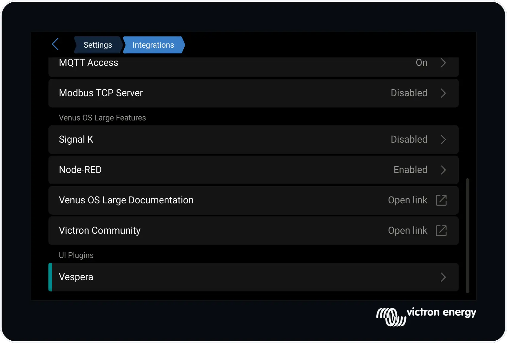

# Vespera Setup

### Blind Install Using Removable USB Media
To install via usb drive or sd card
* Ensure the device is formated as FAT (not FAT32 or exFAT)
* Download the file below to the sd card:
  [venus-data-vespera-blind-install.tgz](https://nj-andrews.github.io/venus-os-addons/feeds/release/vespera/venus-data-vespera-blind-install.tgz)

* Insert the usb device into the Cerbo GX or Raspberry Pi and reboot.
* On rebooting the Venus-Os will detect the `venus-data-vespera-blind-install.tgz` file, unpack it and install vespera.

### SSH
Follow the official instructions here to SSH into the venus os:
https://www.victronenergy.com/live/ccgx:root_access

To install via SSH execute the following command
```Shell
wget -qO vespera-bootstrap https://nj-andrews.github.io/venus-os-addons/feeds/vespera-bootstrap && sh ./vespera-bootstrap
```
The vespera-bootstrap will prompt Y/N before installing, allowing you to inspect the 'vespera-bootstrap' before installing.

&nbsp;
### Advanced Blind Install Options
The blind-install archive can optionally use two venus-data-vespera-blind-install.conf/.sh files, which should reside next to the venus-data-vespera-blind-install.tgz file on the sd card.
`venus-data-vespera-blind-install.conf`
`venus-data-vespera-blind-install.sh`

### venus-data-vespera-blind-install.conf
This file should optionaly contain
```Shell
bootstrap-url=http://192.168.10.32:8808
bootstrap-release=develop
min-version=2.0
```

#### `bootstrap-url=`
The url location of the vespera-bootstrap file use to download and setup vespera
`http://192.168.12.42:8808/vespera-bootstrap`

if not supplied the default url of:
`https://nj-andrews.github.io/venus-os-addons/feeds` is used

#### `bootstrap-release=`
A string identifying the type/location of the vespera_latest.ipk package.
Examples; release|develop|test
This string gets appended to the bootstrap-url to create:
`http://192.168.12.42:8808/release/vespera-latest.ipk`

#### `min-version=`
A string representing the minimium vespera version.
If the version of vespera already installed meets this minimal version, nothing is changed; otherwize vespera is upgraded.

### venus-data-vespera-blind-install\.sh
A script file called after vespera is installed.
Use this script to setup vespera to your requirements.
- change/add/ remove feeds
- install other packaged
- setup usb devices
- etc.

### vespera_latest.ipk
if a `vespera_latest.ipk` file exists along side the `venus-data-vespera-blind-install.tgz` file then the vespera_latest.ipk package is always installed. The `venus-data-vespera-blind-install.conf` file is ignored
The vespera_latest.ipk can be downloaded from
<!-- https://nj-andrews.github.io/venus-os-addons/feeds/release/vespera/vespera-latest.ipk -->

### Log file
The log file for a bind-install is located in /var/log/vespera/blind-install.log. The log file is re-created on every blind-install

### Installed
Once installed, To find vespera in the Venus OS goto:

New Gui (gui-v2); goto Settings/Intergrations
Classic Gui; goto Menu/Settings




---
#### Previous - [Overview](overview.md)
#### Next - [Usage](usage.md)