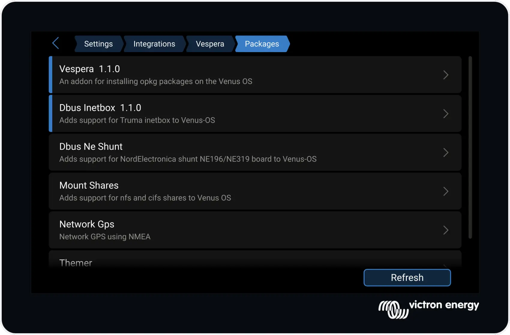
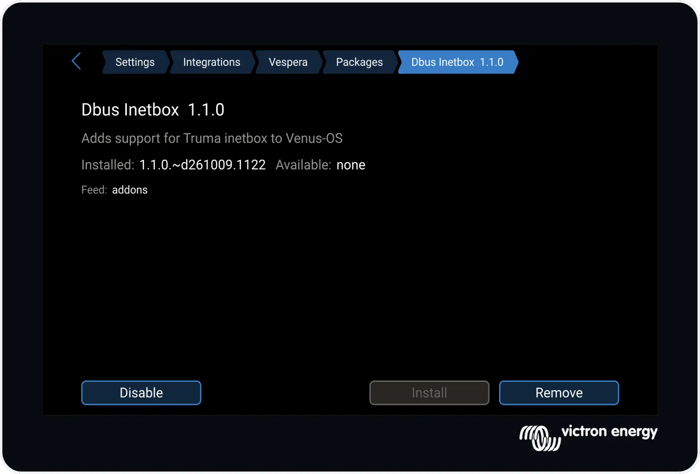
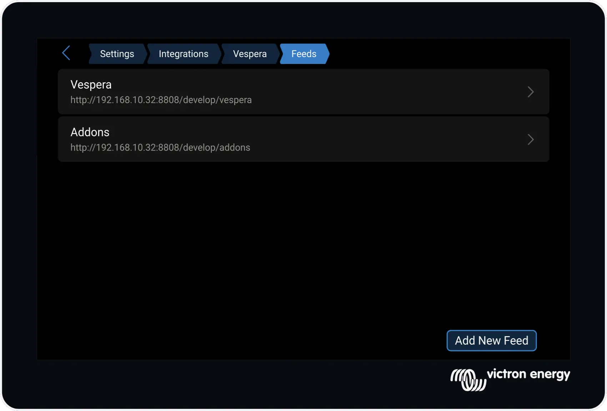
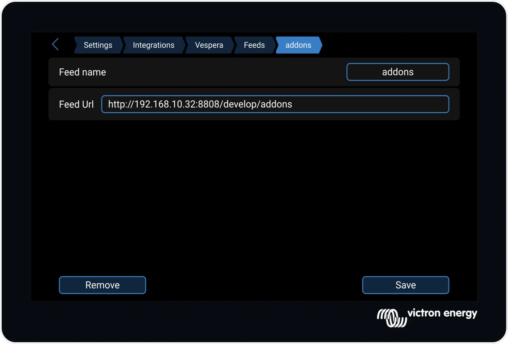
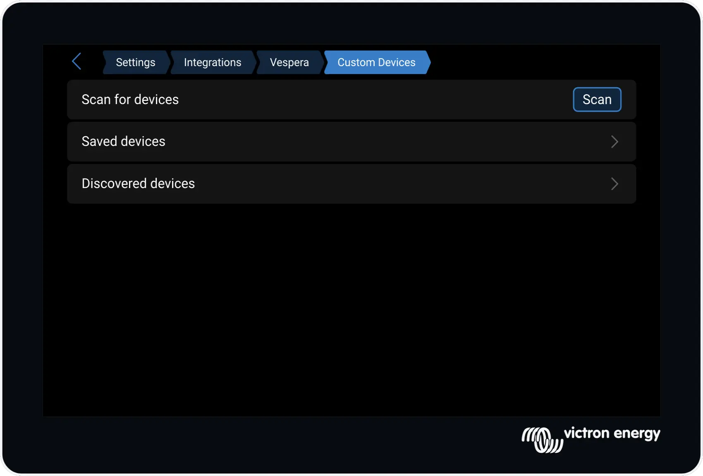
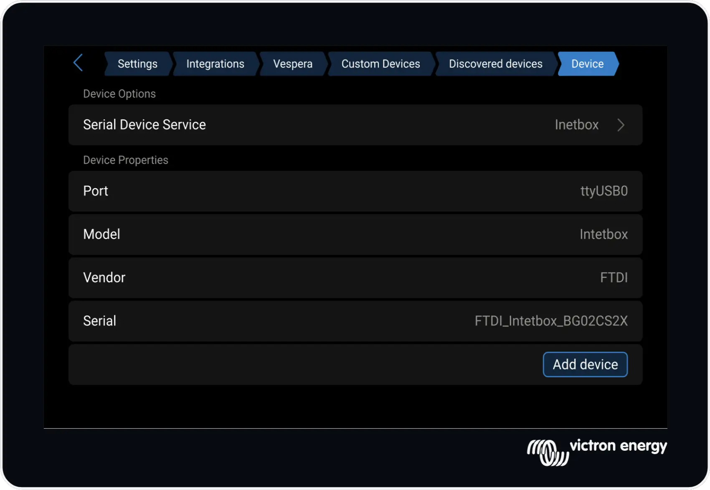
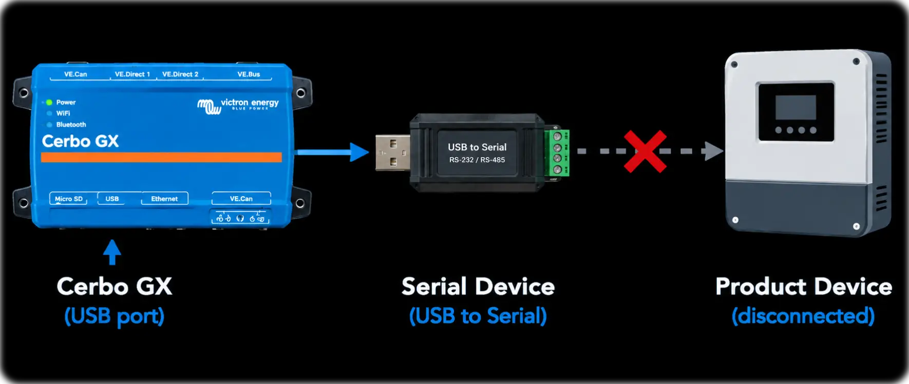

# Vespera Usage

This guide walks you through the basic use of Vespera, including how to manage packages and feeds, install USB serial devices, and safely preview changes before applying them.

For command-line usage and scripting, see the [Vespera CLI reference](cli.md).

### Packages
The the Packages page list all the available packages from all the configured feeds.

Click on a package to see more details about a package and to manage the package.

#### Typical workflow:

1. Open `Menu -> Settings -> Open Package Manager`.
2. Open the **Packages** list.
3. Select a package to view details and available actions.
4. From here you can Install,Remove or Upgrade packages.
6. Confirm the operation.

#### What to expect:

* Vespera resolves dependencies before applying changes.
* If dependencies cannot be satisfied, the operation is blocked and an error is shown.
* If the package contains Venus Intergrations, the UI may be interupted while its reloaded.

You can also Disable and Enable packages. Disablng a package, stops all its services, and disables any Venus intergrations for the package, without removing any files or settings. The services and UI plugin will not be started until explicitly Enabled.

You cannot by default remove or disable the Vespera Package from the gui. (You can using the vespera CLI)

#### Indicators
Packages are color coded with an indicator color.
⬛ [No color]; Package is not installed.
🟦 Package is installed and is upto date
🟨 Package is installed, an update is available
When either of this indicator colors show as dimmed it means the package is currently disabled.

### Feeds
Feeds are package sources. The **Feeds** page lets you manage which repository Vespera uses to download packages from.

#### Common feed tasks:

* Add a feed by providing a feed name and URL.
* Remove a feed that is no longer needed.
* Refresh feed indexes so the package list reflects the latest available versions.

The Vespera feed cannot be edited or removed.

#### Recommendations

* Prefer trusted release feeds for stable systems.
* Use development feeds only when testing and you are prepared for breakage.
* Keep the number of active feeds minimal to reduce conflicts between package versions.

### Custom Devices
The Custom Devices paged helps to bind supported USB serial devices to a selected service.

#### Basic usage:

1. Ensure the usb serial device to use is connected via a USB port
2. Install the package that supports the device you want to bind to. ie. dbus-inetbox. Read any documentation about the suported hardware.
4. Open the **Custom Devices** page in Vespera.
5. Click the "Scan" button; After a few seconds, available device(s) will appear in the "Discovered Devices" page.
6. Click to select the device to bind to.
7. Select the service to bind to the device. **Note: Only packages that have registered services for binding will appear in the list**.
8. Finally click the "Add Device" button and the device should then bind to the service.
9. Depending on the device, it should now appear and be running in the Venus OS.

10. Use the Vespera>Discovered Devices to view existing bound devices, and remove the binding.

#### Recomendations

You must be very carful that you select the correct service for teh device. In most cases nothing will happen, if you do, but there is a chance of hardware misconfiguration if you select the wrong service/device combination.
It is recommended that the serial device is connected to the Cerbo Gx, but not the physical device until **after** you have bound the device and service in Custom Settings.
This can be important because the Venus-Os serial-starter service, constantlty probes for serial devices. This probing can echo's packets back to the device cauing unexpeted behaviour.

---
#### Previous - [Setup](setup.md)